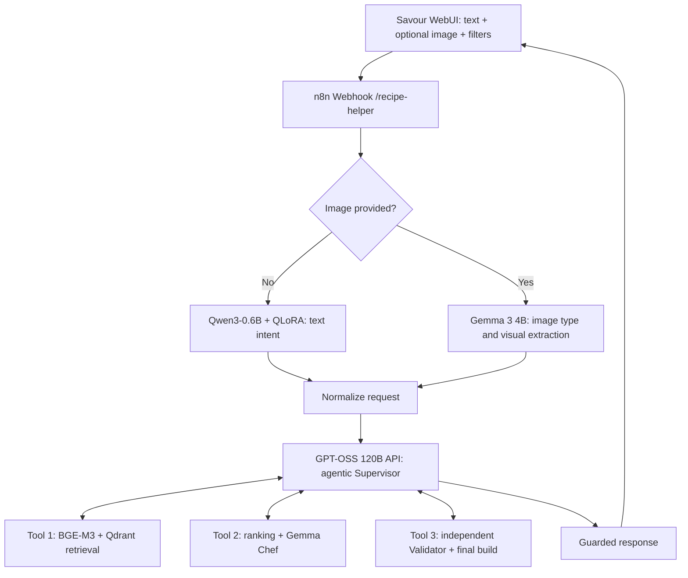

# Recipe Helper

**Intelligent Multimodal Recipe Assistant — RAG, Agentic AI, and QLoRA**

Recipe Helper is a cooking assistant that accepts natural-language requests and food images through the **Savour WebUI**. It interprets the request, retrieves recipes from a Qdrant knowledge base, ranks them against the user's preferences and available ingredients, and provides a recipe after an independent validation step.

The project combines locally hosted specialist models with an API-based agentic Supervisor. It is designed for the **Advanced Deep Learning** project at ESPRIT.

## 1. Supported requests

| Input | Expected behavior |
| --- | --- |
| Ingredients typed by the user | Search for recipes using those ingredients; distinguish available and missing items. |
| Photo of food ingredients | Identify visible foods with uncertainty handling, then prioritize matching recipes. The photo can show a fridge, groceries, a countertop, or another setting. |
| Name or photo of a prepared dish | Find a similar recipe; do not assume the photographed dish's ingredients are available at home. |
| Image of a recipe or recipe document | Extract and preserve its content; keep the user's document authoritative when applicable. |
| Text and image together | Combine the written request with visual evidence and explicit interface filters. |

The WebUI exposes filters for maximum time, vegetarian preference, cuisine, maximum calories, and minimum protein. The intended rule is that explicit interface filters take priority over model-inferred preferences. A recipe may still require ingredients absent from an image; the system should disclose those rather than imply they were detected.

## 2. Architecture



The Supervisor **orchestrates three tools**; they are not three independently deployed autonomous agents. The agent can use feedback to decide whether another search or validation attempt is needed, subject to limits and the configured workflow. Retrieved recipe facts are the source of truth for database-backed recommendations. The Chef adds limited guidance rather than rewriting the source recipe freely.

### Model and tool responsibilities

| Responsibility | Component | Deployment |
| --- | --- | --- |
| Input interface | Savour WebUI | Browser |
| Routing and tool orchestration | n8n | Self-hosted |
| Image routing, ingredient/dish recognition, document parsing | `gemma3:4b` | Ollama, local |
| Text-only intent extraction | `recipe-intent-lora:latest` (fine-tuned Qwen3-0.6B) | Ollama, local |
| Embeddings | `bge-m3` | Ollama, local |
| Vector search and recipe metadata | Qdrant, `recipes_v4` | Self-hosted |
| Recipe guidance | `gemma3:4b` | Ollama, local |
| Agentic Supervisor | `openai/gpt-oss-120b` | External LLM API |
| Independent recipe validation | Validator tool; archived workflow uses `qwen2.5:3b` | Ollama, local in the available export |

**Deployment distinction:** the earlier exported workflow files available for this project still connect the Supervisor to a local `qwen2.5:3b` model. The working Supervisor was subsequently changed in n8n to an **API-based `openai/gpt-oss-120b` model**. For an accurate submission and reproducible installation, export that working configuration from n8n and include it with the project. The API provider/credential must be selected in the imported workflow; a model name alone does not configure access.

Because the Supervisor uses an external service, **the complete system is neither fully offline nor guaranteed free of per-request API charges**. Local image analysis and embeddings remain local; request information passed to the Supervisor can leave the machine.

## 3. Dataset and retrieval

The reported current collection is **`recipes_v4` with approximately 221,741 indexed recipe records**. Recipe payloads can contain the title, ingredients, steps, time, cuisine, nutrition values, vegetarian metadata, and an image URL. Search uses **BGE-M3 embeddings** and Qdrant payload filtering, followed by recipe ranking.

Ingredient-aware ranking considers the requested dish, overlap with confirmed ingredients, and missing recipe ingredients. Vision output is imperfect: recognized foods and confidence scores are evidence to evaluate, not a guaranteed inventory. The application must not count uncertain detections as confirmed ingredients.

The old `recipes_rich` collection (5,845 recipes) belongs to an earlier prototype. Its indexer and numbers must not be used to describe the current `recipes_v4` deployment.

### Verify the existing collection

With Qdrant running on port 6333:

```bash
curl -fsS http://localhost:6333/collections/recipes_v4 | python3 -m json.tool
```

Check the collection's vector configuration and point count. The data volume or an existing Qdrant snapshot is required to reproduce this full collection; **importing an n8n workflow does not populate Qdrant**. The previously documented `scripts/index_rich.py` creates the older `recipes_rich` collection and is **not** a verified replacement for the `recipes_v4` indexing process.

## 4. Requirements

- Linux development machine with Docker Engine and the Docker Compose plugin.
- Ollama installed on the host; Qdrant and n8n can run in containers.
- A browser and Python 3 for hosting the standalone Savour WebUI locally.
- An n8n-compatible API credential for the external `openai/gpt-oss-120b` Supervisor.
- A populated `recipes_v4` Qdrant collection and a copy of the final workflow export.
- For reproducing fine-tuning or its evaluation: Python 3.10 virtual environment and the separately supplied training scripts/data. **Fine-tuning is not required just to use an already exported Ollama model.**

Development used **n8n 2.42.4** and a laptop **RTX 3050 (4 GB VRAM)** for the QLoRA experiment. GPU resources are limited: simultaneous Ollama models may exhaust VRAM. Other operating systems or hardware configurations require testing.

## 5. Install and start the services

### 5.1 Docker, n8n and Qdrant

If the repository already contains a working `docker-compose.yml`, keep it. For a new local-only setup, the following minimal Compose configuration provides n8n and Qdrant with persistent volumes:

```yaml
services:
  n8n:
    image: n8nio/n8n:2.42.4
    restart: unless-stopped
    ports:
      - "127.0.0.1:5678:5678"
    extra_hosts:
      - "host.docker.internal:host-gateway"
    volumes:
      - n8n_data:/home/node/.n8n

  qdrant:
    image: qdrant/qdrant
    restart: unless-stopped
    ports:
      - "127.0.0.1:6333:6333"
    volumes:
      - qdrant_data:/qdrant/storage

volumes:
  n8n_data:
  qdrant_data:
```

From the directory containing that Compose file:

```bash
docker compose up -d
docker compose ps
curl -fsS http://localhost:6333/collections
```

Open `http://localhost:5678` and complete the initial n8n owner-account setup if necessary. **Do not delete or replace an existing Qdrant volume** containing `recipes_v4`.

### 5.2 Ollama and local models

Install Ollama using the instructions at <https://ollama.com/download>, then make sure these models are available:

```bash
ollama pull gemma3:4b
ollama pull qwen2.5:3b
ollama pull bge-m3
ollama list
```

The custom model **`recipe-intent-lora:latest`** was trained and imported separately. It must also appear in `ollama list`; it cannot be recreated by `ollama pull recipe-intent-lora` unless it has been published to an accessible Ollama registry.

If you have the previously merged GGUF model, Ollama can import a local GGUF file using a `Modelfile` and `ollama create`. Otherwise, restore the original LoRA adapter and follow the project's merge/conversion/deployment scripts. The original pretrained Qwen3-0.6B model alone is **not** the fine-tuned intent model.

The exported n8n HTTP nodes target `http://host.docker.internal:11434`. On Linux, the Ollama service must listen on an interface reachable from the Docker bridge. A systemd override can set:

```ini
[Service]
Environment="OLLAMA_HOST=0.0.0.0:11434"
```

Restart Ollama after applying the override and test host access:

```bash
sudo systemctl daemon-reload
sudo systemctl restart ollama
curl -fsS http://localhost:11434/api/tags
```

**Security:** binding Ollama to `0.0.0.0` can expose an unauthenticated model API on other interfaces. Use host firewall/network rules so only trusted local clients and the n8n container can reach port 11434; never publish that port to the internet.

Test container-to-host access (if `wget` is available in the container):

```bash
docker compose exec n8n wget -qO- http://host.docker.internal:11434/api/tags
```

### 5.3 Import and configure the n8n workflow

The application uses **POST `/webhook/recipe-helper`**. There are two export layouts in the project's development artifacts:

**Single-workflow export:** the version titled *Recipe Helper — Universal AI + Ingredient Coverage + Validation Recovery* contains three **embedded** `toolWorkflow` definitions. Import the self-contained JSON, and configure its Supervisor's LLM node to use the external API model and secure credentials.

**Separate-workflow export:** the earlier package contains one parent workflow (`01-recipe-helper-supervisor.json`) plus three sub-workflows (`02-sub-search-embed.json`, `03-sub-rank-chef.json`, and `04-sub-validate-final-build.json`). Import the three tools first, then the parent, and connect each parent's tool node to the **actual imported sub-workflow ID**. That earlier package is not a substitute for the current self-contained export without this linking step.

In n8n, use the workflow menu to import the JSON file, then verify:

1. The Supervisor uses **`openai/gpt-oss-120b` via the intended API provider** and a working n8n credential.
2. The text intent HTTP node uses **`recipe-intent-lora:latest`**, not the old `qwen2.5:3b` classifier.
3. The vision, Chef, and Validator nodes use the local models configured in the active workflow.
4. Qdrant search and recipe-fetch nodes target **`recipes_v4`**, and all tool nodes are connected.
5. The final output passes through the validation/response guard.

Save the workflow and activate/publish it according to the installed n8n version. **Only one active production workflow should own `/webhook/recipe-helper` on the same n8n instance.** The exact file exported from the working API-Supervisor configuration is the version to submit with the project.

### 5.4 Launch Savour WebUI

If using the supplied standalone interface, serve its directory locally:

```bash
python3 -m http.server 8080 --bind 127.0.0.1
```

Open the standalone HTML file from `http://localhost:8080/` (for example, `savour-recipe-standalone.html` if that file is included). In the WebUI connection settings, use:

```text
http://localhost:5678/webhook/recipe-helper
```

The browser sends JSON with `query`, `filters`, and an optional Base64-encoded `image_b64`. Images are not multipart uploads in this WebUI implementation. If the browser reports a CORS error, configure an allowed origin in the webhook/reverse-proxy setup or serve the interface through the same origin; changing model prompts will not fix CORS.

## 6. Run a test

With the production webhook enabled, a text-only smoke test can be sent directly:

```bash
curl -sS -X POST 'http://localhost:5678/webhook/recipe-helper' \
  -H 'Content-Type: application/json' \
  --data '{
    "query": "I have eggs and tomatoes. Suggest a quick recipe.",
    "filters": {"max_minutes": 30, "vegetarian": true}
  }' | python3 -m json.tool
```

In Savour WebUI, also test (1) a text-only dish, (2) an ingredients image, (3) a prepared-dish photo, and (4) a recipe screenshot. Inspect n8n **Executions** for the normalized request, detected ingredients, retrieved candidates, selected recipe, Validator status, and final response.

For image + text requests, verify that UI filters survive the image branch. Photo-derived ingredients can be uncertain; any actual missing ingredients should remain visible in the recommendation or response context. An agent returning `DONE` is **not** itself proof that the Validator approved the recipe—inspect the real validation tool output.

## 7. Evaluation

### 7.1 Retrieval

Reported Hit@K results from the project's Qdrant collection comparison:

| Collection | Hit@3 | Hit@5 | Hit@10 |
| --- | ---: | ---: | ---: |
| `recipes_fixed` | 0.90 | 0.90 | 1.00 |
| `recipes_struct` | 0.90 | 0.90 | 1.00 |
| `recipes_rich_2k` | 1.00 | 1.00 | 1.00 |
| `recipes_rich` | 0.60 | 0.70 | 0.80 |
| `recipes_v4` | 0.80 | 0.85 | 0.95 |

These are **reported experiment results**, not a claim that the collections contain equally many recipes or were evaluated under identical conditions. In particular, do not infer that `recipes_v4` has the highest Hit@K. The supplied `recipes_v4` MRR figures require recalculation: under standard definitions on the same query set, **MRR@K cannot exceed Hit@K**, yet some supplied pairs do. Those MRR figures are omitted until the evaluation calculation is verified.

### 7.2 QLoRA intent extraction

The base Qwen3-0.6B model was compared with the fine-tuned LoRA model on **57 held-out synthetic examples** (455 train / 57 validation / 57 test from 569 examples):

| Metric | Base | Fine-tuned |
| --- | ---: | ---: |
| Valid JSON | 87.72% | **100.00%** |
| Intent accuracy | 35.09% | **98.25%** |
| Exact structured output | 1.75% | **84.21%** |

The fine-tuned model was merged, converted to GGUF, imported into Ollama as `recipe-intent-lora:latest`, and smoke-tested. These metrics establish improvement on the synthetic held-out sample only; they are **not** a real-world production accuracy estimate. Some informal multilingual/Arabizi requests still produced incorrect ingredient identities.

### 7.3 End-to-end checks

The key functional checks are: correct input routing; reasonable ingredient detections; preservation of explicit filters; relevant candidate retrieval; transparent available/missing ingredient comparison; actual execution of Search → Rank + Chef → Validator; and a guarded final response. Record observed outcomes and execution IDs when running the deployed system; an individual successful demonstration is not a statistical performance benchmark.

## 8. Safety, security and privacy

- **Grounded output:** database-backed recipe fields should come from Qdrant or a user-supplied recipe document; Chef text is supplementary.
- **Independent validation:** the Validator tool reviews proposed output, and a response guard must prevent unapproved recipes being presented as approved. An LLM cannot guarantee that every recipe is medically or allergen safe.
- **Prompt injection:** image text, recipe documents and user messages are untrusted input, not higher-priority workflow instructions. Maintain strict tool contracts and validate tool inputs.
- **API secrets:** keep external-model credentials in n8n credential storage or protected server configuration; never commit API keys, raw n8n credentials, or `.env` secrets. Review exported workflows before publication.
- **Privacy:** the local Ollama stages run on the host, but text/context passed to an external Supervisor API may leave the local machine. Review the provider's data-handling terms before processing personal information.
- **Network exposure:** run the WebUI, n8n, Qdrant and Ollama on trusted interfaces; secure any remote access with HTTPS and authentication. Do not expose Qdrant or Ollama publicly without appropriate controls.

## 9. Troubleshooting

| Symptom | Check or action |
| --- | --- |
| `recipe-intent-lora` not found | Check `ollama list`; custom LoRA import is required, not a normal public model pull. |
| CUDA out of memory | Check `nvidia-smi` and `ollama ps`. Unload idle models with `ollama stop MODEL_NAME`; do not terminate unidentified processes. |
| n8n cannot reach Ollama | Check `OLLAMA_HOST`, firewall restrictions, Docker `extra_hosts`, and `http://host.docker.internal:11434/api/tags` from the n8n container. |
| No Qdrant collection or candidates | Verify `recipes_v4` exists and is populated; importing a workflow does not load the recipe corpus. |
| Browser `Failed to fetch` | Verify webhook URL, n8n activation, CORS/reverse proxy, and network connectivity. |
| Supervisor stops before Validator | Inspect tool-call trace and chosen recipe ID; ensure the external Supervisor model has tool calling enabled and the validation guard remains connected. |
| Recipe poorly matches available foods | Compare vision inventory, confidence, candidates, ingredient overlap and missing ingredients in the ranking tool. |
| Textual vegetarian/time request ignored | Check the normalized request and UI filter values; UI filters should override uncertain language extraction. |
| Workflow import shows missing tools | Determine whether the export is embedded or four-workflow; link sub-workflow IDs if separate. |
| Qdrant API method warning | Older workflow exports use `/points/search`. Modern Qdrant documentation recommends `/points/query`; migrate only alongside a tested request/response adapter. |

## 10. Reproducibility and academic deliverables

A complete submission should include the **exported, currently running n8n workflow**, the Savour WebUI, a description of how to restore/build `recipes_v4`, evaluation code and raw test data where available, the training/evaluation configuration for the QLoRA experiment, the technical report PDF, the prompt library, and the completed project labs. The prompt library belongs in the report appendix as requested for the module.

The workflow export must be reviewed for private URLs, tokens, credential data and production-only configuration before it is shared. The active API-Supervisor workflow—not the earlier local-Supervisor prototype—is the authoritative submission artifact.

## 11. References

- [n8n documentation](https://docs.n8n.io/)
- [Ollama documentation](https://docs.ollama.com/)
- [Qdrant search documentation](https://qdrant.tech/documentation/search/)
- [Food.com Recipes and Interactions dataset](https://www.kaggle.com/datasets/shuyangli94/food-com-recipes-and-user-interactions)
