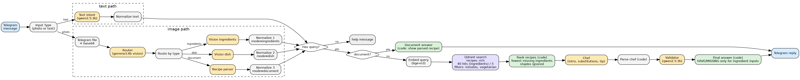

# Recipe Helper

A multimodal, multi-agent recipe assistant on Telegram. Send it **a photo of your ingredients, a photo of a dish, a screenshot of a recipe, or text**, and it answers with a recipe that fits the input.

Final project of *Advanced Deep Learning* (Esprit, 5DS, 2026-2027): AI automation with prompt engineering, RAG, multi-agent design and multimodality.
Author: Najd Rahmani.

Everything runs **locally and for free**: n8n (automation), Ollama (`gemma3:4b`, `qwen2.5:3b`, `bge-m3`) and Qdrant (vector store), all on one machine. No cloud API, no fine-tuning.

---

## Contents

1. [What it does](#1-what-it-does)
2. [How it works](#2-how-it-works)
3. [Requirements](#3-requirements)
4. [Repository layout](#4-repository-layout)
5. [Setup, step by step](#5-setup-step-by-step)
6. [Run it](#6-run-it)
7. [Evaluation and tests](#7-evaluation-and-tests)
8. [Configuration](#8-configuration)
9. [Troubleshooting](#9-troubleshooting)
10. [Known limits](#10-known-limits)
11. [Where each course requirement lives](#11-where-each-course-requirement-lives)
12. [Security and data](#12-security-and-data)

---

## 1. What it does

The answer depends on what the user sends.

| Input | What the user gets |
|---|---|
| **Ingredients** (photo, or text such as `I have eggs, tomatoes and cheese`) | The recipe that needs the **fewest extra ingredients**, with "You have" and "Missing", up to 3 substitutions, the steps, and 2 other close options |
| **Dish** (photo, or a dish name such as `lasagna`) | The recipe with "Ingredients needed" and steps. No have/missing, because the user has not said what they own |
| **Recipe screenshot** | The recipe as extracted from the image (ingredients with quantities, steps). No have/missing, no database search |
| **Text in French or Arabic** | Understood and translated to English before searching |

Extra options (text, or the caption of a photo): `vegetarian`, and a time limit such as `under 30 minutes` or `30 min`.

Message format (illustrative example for an ingredients photo):

```
Simple chicken rice (30 min)
Easy.

Detected in your photo: chicken, rice, onion, garlic

You have (4 of 4): chicken, rice, onion, garlic
You have everything you need!
Pantry basics: salt, water, olive oil

Steps:
1. ...

Other close options: Chicken rice bake (missing 2); Chicken tikka (missing 5)

Tip: ...
```

Salt, pepper, water, oil and sugar are treated as pantry basics and never counted as missing.

---

## 2. How it works



1. **Telegram Trigger** receives the message and a progress message is sent right away (analysis can take minutes on CPU).
2. **Input Type** switch: photo or text.
3. **Text path:** the *Text intent* agent (`qwen2.5:3b`) decides whether the user listed ingredients or named a dish, extracts a time limit and the vegetarian flag, and translates to English.
4. **Image path:** the photo is downloaded, converted to base64, and the **Router** agent (`gemma3:4b`, vision) classifies it as `ingredients_photo`, `dish_photo` or `recipe_document`. One vision agent then reads it: *Vision ingredients*, *Vision dish* or *Recipe parser*.
5. A **Normalize** node turns every input into one contract: `{mode, query, user_ingredients, filters}`.
6. **Recipe screenshots** go straight to the *Document answer* node and skip retrieval.
7. Other inputs: the query is embedded with `bge-m3` and searched in Qdrant (`recipes_rich`, with optional filters on cooking time and the vegetarian tag).
8. **Rank recipes** (code): for ingredient inputs it takes the top 40 candidates and keeps the recipe with the fewest missing ingredients; for dish and text inputs it takes the top 5 and prefers names that contain the query words.
9. **Chef** agent (`gemma3:4b`): returns JSON with an intro sentence, up to 3 substitutions and one tip.
10. **Parse chef** (code) removes invalid substitutions; **Validator** agent (`qwen2.5:3b`) judges whether each substitution is sensible (fail-open); **Final answer** (code) builds the Telegram message and keeps it under 4000 characters.

Design rule learned from the failures (see `prompts/prompt_library.md`): the small models only read images, understand free text and suggest substitutes. Everything countable or checkable (which recipe, have/missing sets, steps, formatting, length) is done by code.

### Agents

| Agent | Model | Input | Output |
|---|---|---|---|
| Router | gemma3:4b (vision) | image | type, confidence |
| Vision ingredients | gemma3:4b | image | ingredients with confidence |
| Vision dish | gemma3:4b | image | dish name |
| Recipe parser | gemma3:4b | image | title, ingredient lines, steps |
| Text intent | qwen2.5:3b | message | ingredients or dish, time limit, vegetarian, English |
| Chef | gemma3:4b | chosen recipe, have, missing | intro, substitutions, tip |
| Validator | qwen2.5:3b | substitutions | one verdict per substitution |

Retrieval and ranking are tools (Qdrant search plus a code node), not agents.

### Knowledge base

- Corpus: Food.com recipes (`RAW_recipes.csv`, more than 180,000 recipes). The first 6,000 rows are indexed; recipes with fewer than 3 ingredients or 2 steps are skipped (5,845 indexed in our run).
- Three chunking strategies are compared: `recipes_fixed` (800-character windows, 100 overlap), `recipes_struct` (ingredients chunk and steps chunk per recipe) and `recipes_rich` (one chunk per recipe, `name. Ingredients: ...` embedded, full recipe in the payload). The workflow uses `recipes_rich`.
- Embeddings: `bge-m3` (1024 dimensions). Store: Qdrant, cosine distance, payload indexes on `minutes` and `tags`.

---

## 3. Requirements

| Item | Needed |
|---|---|
| OS | Linux (developed on Ubuntu 24.04). macOS and Windows should work with Docker Desktop but were not tested |
| RAM | 16 GB recommended. The models need about 6.5 GB on disk (`gemma3:4b` 3.3 GB, `qwen2.5:3b` 1.9 GB, `bge-m3` 1.2 GB) |
| GPU | Optional. Without a GPU, each photo takes several minutes |
| Disk | About 10 GB free, plus about 900 MB for the Kaggle download |
| Software | Docker Engine with the Compose plugin, Ollama, Python 3.10+, Node.js 18+ (only for the unit tests), `cloudflared` (only for Telegram) |
| Accounts | A Telegram account (bot from @BotFather) and a free Kaggle account (to download the dataset) |

Tested with n8n 2.42.4 (self-hosted, Docker).

---

## 4. Repository layout

```
recipe-helper/
├── README.md
├── docker-compose.yml          n8n + Qdrant
├── .gitignore                  .venv/, data/RAW_recipes.csv, .env
├── data/                       RAW_recipes.csv goes here (not committed)
├── workflows/
│   ├── recipe-helper-telegram-v2.json   CURRENT workflow (use this one)
│   ├── recipe-helper-telegram.json      first Telegram version (kept for the before/after)
│   ├── recipe-helper-full.json          early Form-trigger version (v1 prompts, no Telegram)
│   └── recipe-helper.json               canonical export of the Form version
├── scripts/
│   ├── index.py                 builds recipes_fixed and recipes_struct (chunking comparison)
│   ├── index_rich.py            builds recipes_rich (used by the workflow)
│   ├── eval.py                  retrieval evaluation, 10 queries, hit@k and MRR
│   ├── eval_ingredients.py      simulated "user has these ingredients" evaluation
│   ├── ranker.py                Python copy of the ranking node, used by eval_ingredients.py
│   ├── e2e_test.py              terminal harness of the v1 pipeline (plumbing check only)
│   └── build_full_workflow.py   generator of the early Form workflow
├── prompts/prompt_library.md    versioned prompts, failures, fixes
├── eval/
│   ├── queries.csv              10 retrieval test queries
│   ├── results.txt              retrieval scores
│   ├── results_ingredients.txt  ingredient-matching scores
│   ├── e2e_tests.md             test tables (harness, live failures, v2 test plan)
│   ├── images/                  test photos (optional)
│   └── runs/                    JSON outputs of the terminal harness
├── report/
│   ├── report.md                technical report
│   └── architecture.png/.svg/.dot
└── tests/
    ├── test_js.js               27 unit tests of the n8n code nodes
    └── js/                      copies of the code nodes (the workflow JSON is the source of truth)
```

---

## 5. Setup, step by step

### 5.1 Install Docker

Follow https://docs.docker.com/engine/install/ubuntu/ (Docker Engine + Compose plugin), then:

```bash
sudo systemctl enable --now docker
sudo usermod -aG docker $USER
newgrp docker
docker run hello-world
```

If Docker complains about `docker-credential-desktop`, a leftover Docker Desktop config is the cause:
```bash
cp ~/.docker/config.json ~/.docker/config.json.bak && echo '{}' > ~/.docker/config.json
```

### 5.2 Install Ollama and the models

```bash
curl -fsSL https://ollama.com/install.sh | sh
ollama pull gemma3:4b
ollama pull qwen2.5:3b
ollama pull bge-m3
```

Make Ollama reachable from the n8n container (it listens on localhost only by default):

```bash
sudo mkdir -p /etc/systemd/system/ollama.service.d
printf '[Service]\nEnvironment="OLLAMA_HOST=0.0.0.0"\n' | sudo tee /etc/systemd/system/ollama.service.d/override.conf
sudo systemctl daemon-reload
sudo systemctl restart ollama
ss -tlnp | grep 11434        # must show *:11434 or 0.0.0.0:11434
```

If a firewall (ufw) is active, allow Docker's networks to reach Ollama:
```bash
sudo ufw allow from 172.16.0.0/12 to any port 11434 proto tcp
```

### 5.3 Get the code and the dataset

```bash
git clone <your-repo-url> recipe-helper
cd recipe-helper
mkdir -p data
```

Download **Food.com Recipes and Interactions** from Kaggle (https://www.kaggle.com/datasets/shuyangli94/food-com-recipes-and-user-interactions), then extract only the file we use:

```bash
unzip ~/Downloads/archive.zip RAW_recipes.csv -d data/
head -c 300 data/RAW_recipes.csv      # header: name,id,minutes,contributor_id,submitted,tags,nutrition,n_steps,steps,description,ingredients,n_ingredients
```

Use `RAW_recipes.csv`, not `PP_recipes.csv` (the latter is tokenised numbers).

### 5.4 Start n8n and Qdrant

`docker-compose.yml` (use this if you do not have one yet):

```yaml
services:
  n8n:
    image: n8nio/n8n
    restart: unless-stopped
    ports: ["5678:5678"]
    environment:
      - N8N_SECURE_COOKIE=false          # local http only
      - WEBHOOK_URL=${WEBHOOK_URL:-http://localhost:5678}
    extra_hosts:
      - "host.docker.internal:host-gateway"   # lets n8n reach Ollama on the host (needed on Linux)
    volumes: ["n8n_data:/home/node/.n8n"]
  qdrant:
    image: qdrant/qdrant
    restart: unless-stopped
    ports: ["6333:6333"]
    volumes: ["qdrant_data:/qdrant/storage"]
volumes:
  n8n_data:
  qdrant_data:
```

```bash
docker compose up -d
docker compose ps                                   # both services running
curl -s http://localhost:6333/collections           # Qdrant answers
docker compose exec n8n wget -qO- http://host.docker.internal:11434/api/tags   # lists your 3 models
```

Open http://localhost:5678 and create the owner account (first start only).

### 5.5 Python environment and indexing

```bash
python3 -m venv .venv
source .venv/bin/activate
pip install pandas qdrant-client ollama
python scripts/index_rich.py            # 6000 recipes, about 10 to 20 minutes on CPU
```

Use a different corpus size with `python scripts/index_rich.py 8000`. It ends with `recipes_rich done <count>`.

Optional, to reproduce the chunking comparison (adds `recipes_fixed` and `recipes_struct`, first 2,000 recipes):
```bash
python scripts/index.py
```

### 5.5b Telegram bot

1. In Telegram, open **@BotFather**, send `/newbot`, choose a name and a username ending in `bot`, and copy the token.
2. In n8n: **Credentials → Create credential → Telegram API**, paste the token, save. The token lives only in n8n, never in the repository.

### 5.6 Public URL for the Telegram webhook

Telegram needs an HTTPS address that reaches your n8n. On a laptop, use a Cloudflare quick tunnel.

```bash
# install once
curl -L https://github.com/cloudflare/cloudflared/releases/latest/download/cloudflared-linux-amd64.deb -o /tmp/cloudflared.deb
sudo dpkg -i /tmp/cloudflared.deb

# every session (terminal 1, leave it open)
cloudflared tunnel --url http://localhost:5678
```

Copy the printed `https://xxxx.trycloudflare.com` address, then restart n8n with it (terminal 2):

```bash
WEBHOOK_URL=https://xxxx.trycloudflare.com docker compose up -d
docker compose exec n8n printenv WEBHOOK_URL      # must print the same address
```

The address **changes every time the tunnel restarts**, so repeat this step (and the re-publish in 6.2) each session.

---

## 6. Run it

### 6.1 Import the workflow (once)

1. Open http://localhost:5678 (not the tunnel address).
2. **Workflows → ⋯ next to "Create workflow" → Import from file →** `workflows/recipe-helper-telegram-v2.json`.
3. Open the *Telegram Trigger* and each *Send a text message* node and select your **Telegram account** credential.
4. The Ollama and Qdrant calls are plain HTTP nodes (`http://host.docker.internal:11434`, `http://qdrant:6333`), so they need no credential.
5. Click **Save**.

### 6.2 Publish and use

1. Make sure no other workflow uses the same Telegram bot (a bot can have only one trigger): unpublish `recipe-helper-telegram` if it is published.
2. Click **Publish** on `recipe-helper-telegram-v2`.
3. Open your bot in Telegram and send a message or a photo. You get a "Analyzing your request" message first, then the answer after one to a few minutes.
4. Every run is visible in the **Executions** tab, node by node.

Notes:
- While the workflow is published you cannot use **Execute workflow** (Telegram allows one listener). To debug, **Unpublish**, run, then publish again.
- Send photos as normal photos, not as files.
- Small images (under 1 MB) are faster.

### 6.3 Restart checklist (after a reboot)

```bash
sudo systemctl start docker ollama
cloudflared tunnel --url http://localhost:5678        # terminal 1, copy the address
WEBHOOK_URL=https://xxxx.trycloudflare.com docker compose up -d     # terminal 2
```
Then in n8n: Unpublish and Publish the workflow again (this re-registers the Telegram webhook), and send one message to warm up the models.

### 6.4 Older Form-trigger workflow

`workflows/recipe-helper-full.json` is the first version, triggered by a web form instead of Telegram, using the v1 prompts and the `recipes_fixed` collection (build it with `python scripts/index.py`). It is kept as a reference and as a fallback without a public URL. Use the v2 Telegram workflow for the real behaviour described here.

---

## 7. Evaluation and tests

```bash
source .venv/bin/activate

# 1) retrieval quality: 10 queries, hit@k and MRR for the three chunking strategies
python scripts/eval.py | tee eval/results.txt

# 2) ingredient matching: vector top-1 vs top-40 + rerank, simulated users, source recipe excluded
python scripts/eval_ingredients.py | tee eval/results_ingredients.txt

# 3) unit tests of the code nodes (no Docker or models needed, Node.js 18+)
cd tests && node test_js.js
```

| What | Where | Note |
|---|---|---|
| Retrieval scores and chunking comparison | `eval/results.txt`, `report/report.md` section 3 | 10 queries is a small set, differences of one query are directional |
| Ingredient matching scores | `eval/results_ingredients.txt` | simulated users spell ingredients like the corpus, so this is an upper bound |
| Live Telegram failures and the v2 test plan | `eval/e2e_tests.md` | sections B and C |
| Prompt versions, failures, fixes | `prompts/prompt_library.md` | |
| Terminal harness `scripts/e2e_test.py` | `eval/runs/` | targets the **v1** pipeline; it checks valid JSON and that retrieval returns results, so it measures plumbing and not answer quality |

---

## 8. Configuration

| What | Where to change it |
|---|---|
| Models | the `model` field in each HTTP Request node (Router, Vision x2, Recipe parser, Chef: `gemma3:4b`; Text intent, Validator: `qwen2.5:3b`) |
| Number of candidates | node *RAG search*: `limit` is 40 for ingredient inputs and 5 otherwise |
| Confidence threshold for detected ingredients | node *Normalize 1*: `c >= 0.6` |
| Pantry basics that never count as missing | node *Rank recipes*: the `STAPLES` list (keep `scripts/ranker.py` in sync) |
| Ranking rules (minimum matched ingredients, tie-breaks) | node *Rank recipes* |
| Corpus size | `python scripts/index_rich.py N` |
| Collection used for search | URL of the node *RAG search* (`recipes_rich`) |
| Message length limit | node *Final answer* (3900 characters for steps, 4000 total) |

The files in `tests/js/` are copies of the code nodes for unit testing. After editing a node in n8n, update the copy and re-run the tests.

---

## 9. Troubleshooting

| Symptom | Cause and fix |
|---|---|
| `Connection refused` from a Python script | Qdrant is not running. `docker compose up -d`, then `curl localhost:6333/collections` |
| n8n cannot reach Ollama (timeout) | Ollama listens on localhost only or a firewall blocks it. Apply 5.2 (`OLLAMA_HOST=0.0.0.0`, ufw rule) and re-test with the `wget` command of 5.4 |
| `docker-credential-desktop` not found | Leftover Docker Desktop config. Reset `~/.docker/config.json` (see 5.1) |
| HTTP node: "Method not allowed" | The node is set to GET. All model and Qdrant calls must be **POST**. Re-import the workflow and reload the browser tab |
| HTTP node: "JSON Body is not valid JSON" | Code was pasted into the wrong field. Re-import the workflow |
| Bot never answers | Check, in this order: the `cloudflared` terminal is still running; `docker compose exec n8n printenv WEBHOOK_URL` equals the tunnel address; the workflow is published (Unpublish, then Publish to re-register); the Executions tab shows whether a run started |
| "n8n can't listen for test executions at the same time as production ones" | The workflow is published. Unpublish it before using Execute workflow |
| Telegram 400 "can't parse entities" | Markdown characters in the message. The code nodes already strip them; if you edit those nodes, keep that step |
| "Analyzing..." arrives after the answer | n8n runs the top-most branch first. Keep the progress message node above the Input Type branch |
| `model not found` | `ollama pull gemma3:4b`, `ollama pull qwen2.5:3b`, `ollama pull bge-m3` |
| Very slow answers | CPU inference, one to several minutes per photo is normal. Use smaller photos, keep the models loaded (`ollama run gemma3:4b "hi" --keepalive 30m`), or use a GPU |
| No result or an odd recipe | The corpus holds 5,845 recipes. Try other ingredients, remove the time limit, or index more (`python scripts/index_rich.py 12000`) |

---

## 10. Known limits

- Retrieval was evaluated on only 10 queries, and ingredient matching on simulated users. Real photos and typed lists are messier.
- Ingredient names come from the vision model (`gemma3:4b`) and can be wrong or incomplete on dark, blurry or crowded photos. Low-confidence items are reported to the user as "not sure about".
- The corpus is English. Other languages are translated by the Text-intent agent, but photos of non-English recipe pages are read in their original language.
- Recipe screenshots are shown as extracted; the small vision model can misread quantities.
- The 3B validator was unreliable when it checked counts, lists and grounding (documented in the prompt library), so it only judges substitutions and fails open.
- The Telegram bot works only while the laptop, Docker, Ollama and the tunnel are running. The tunnel address changes at every restart.
- No nutrition data, no allergen checks, no fine-tuning.

---

## 11. Where each course requirement lives

| Requirement | Where |
|---|---|
| Automation platform, triggered end to end | `workflows/recipe-helper-telegram-v2.json` (n8n, started by a Telegram message) |
| Prompt engineering, versioned library, failures, before/after | `prompts/prompt_library.md`, `eval/e2e_tests.md`, `report/report.md` section 2 |
| RAG: corpus, chunking comparison, embeddings, store, retrieval, evaluation | `scripts/index.py`, `scripts/index_rich.py`, `scripts/eval.py`, `scripts/eval_ingredients.py`, `eval/`, `report/report.md` section 3 |
| Multi-agent system and its justification | `report/report.md` section 4, section 2 of this file |
| Multimodality (photos and screenshots) | `report/report.md` section 5, nodes *Router*, *Vision ingredients*, *Vision dish*, *Recipe parser* |
| Technical report | `report/report.md` |

---

## 12. Security and data

- The Telegram token and the n8n password are never stored in the repository. Credentials live in n8n only. If a password was shared or exposed while working, change it (n8n: Settings → Personal).
- `.gitignore` excludes `.venv/`, `data/RAW_recipes.csv` and `.env`.
- Dataset: Food.com Recipes and Interactions (Majumder, Li, Ni, McAuley, *Generating Personalized Recipes from Historical User Preferences*, EMNLP 2019). Data files remain the property of their original authors; this project uses them for coursework only and does not redistribute them.
- Photos sent to the bot are processed locally by Ollama and are not sent to any cloud service. Telegram itself receives and stores the messages, as with any bot.