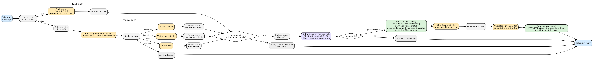

# Recipe Helper: multimodal, multi-agent recipe assistant

Advanced Deep Learning, final project (AI automation). Everything runs locally: n8n, Ollama (`gemma3:4b`, `qwen2.5:3b`, `bge-m3`) and Qdrant in Docker. The user talks to a Telegram bot. No API cost, no fine-tuning.

## 1. Use case and architecture

The user sends a **photo of ingredients**, a **photo of a dish**, a **screenshot of a recipe**, or **text** (ingredients, a dish name; French, Arabic and Tunisian dialect in Latin letters are understood). The answer depends on the input type:

| Input | What the user gets |
|---|---|
| ingredients (photo or text) | the recipe that **needs the fewest extra ingredients**, with "You have" and "Missing", substitutions, steps, and two other close options |
| dish photo or dish name | the recipe with "Ingredients needed" and steps, **no have/missing**; for a photo, the detected dish and its alternatives; if nothing close exists the answer says it is the closest match |
| recipe screenshot | the user's **own recipe** as extracted (ingredient lines with quantities, steps), then a similar recipe from the knowledge base as a labelled reference (close, partial or loose match). No have/missing wording |
| greeting, `/start`, no food content | a help message |
| image that is not food | a polite message |

Pipeline: Telegram trigger, a progress message, and an input switch. Images are downloaded, converted to base64 and classified by the **Router** (four classes). A vision agent (ingredients, dish or recipe parser) returns JSON and a **Normalize** node turns every input into one contract `{mode, query, title_query, user_ingredients, filters}`. Retrieval embeds the query with `bge-m3` and searches Qdrant. A code node **ranks** the candidates and builds the context for the **Chef**, the Chef writes an intro, substitutions and a tip, the **Validator** reviews them, and a code node builds the Telegram message.

n8n workflow: `workflows/recipe-helper-telegram-v3.json`, started by a Telegram message (end to end, no manual step).

## 2. Prompt engineering

Seven prompts are versioned in `prompts/prompt_library.md` (role, technique, versions, full text of the first and the current version, failure, fix). Techniques used: structured JSON output on every agent, role prompting, few-shot examples (router, text intent, vision, parser, chef), explicit class definitions with ordered decision rules (router), a short "visible" description written before the answer (router), guardrails ("only clearly visible", "copy only what is written"), confidence bands and thresholds, translation to English, `temperature 0` on deterministic agents, and **code-level guardrails** around the models.

Seven real failures were found in the first live Telegram tests (full table in `eval/e2e_tests.md`, section B). Main groups:

| Failure | Before | After |
|---|---|---|
| Chef invented a HAVE list when the user gave no ingredients | v1 free text | v2 `NONE PROVIDED`, then HAVE/MISSING computed by code |
| Chef merged several retrieved recipes, message cut off | v2 | v3 one recipe, caps; later the Chef no longer writes the answer |
| Chef echoed its system prompt, printed "HAVE: None" | v3 | v4 code cleanup; v5 the Chef returns JSON only |
| Validator (3B) gave false warnings on three different checks | v1 to v3 | rules moved to code; the LLM only judges text |
| Dish photo: guessed ingredients treated as owned | v1 | a dish photo yields no user ingredients |
| Telegram rejected Markdown characters | v1 | stripped in code |

**Lesson.** A 4B model does not reliably follow "skip this section" or count steps. Anything computable (sets, counts, formatting, length) moved into code, and the models read images, understand text and write short text. This is also why the terminal harness result (16/16) is reported as plumbing only.

**Later improvements (v3).** The router gained a `not_food` class and a `visible` field; the dish agent returns confidence, main ingredients and alternatives; the recipe parser returns English search fields and a `complete` flag; the text agent gained a `help` intent and arabizi examples; the Chef receives a code-built context and is mode-aware; the Validator reviews substitutions, intro and tip, and substitutions fail closed. The motivating failures for these changes, and their measured effect, are recorded in the library where they were observed; items marked "not yet measured" there have not been run. [FILL: results of the hard-image set, case 10 of `eval/e2e_tests.md`]

## 3. RAG

**Corpus.** Food.com recipes (`RAW_recipes.csv`, more than 180,000 recipes). The first 60,000 rows are indexed; recipes with fewer than 3 ingredients or 2 steps are skipped ([FILL: count] indexed). The CSV is structured (name, ingredients, steps, minutes, tags), which suits ingredient matching and filtering. The size is a compromise: a larger corpus gives better matches for "fewest missing ingredients" (more recipes to choose from), but indexing on CPU grows with the number of recipes ([FILL: indexing time] for 60,000 rows on our machine).

**Three chunking strategies compared** (same embedding model and store):

| Collection | Chunking | Points |
|---|---|---|
| `recipes_fixed` | whole recipe text cut in windows of 800 characters, 100 overlap, first 2,000 recipes | 2,832 |
| `recipes_struct` | two chunks per recipe (ingredients, steps), each prefixed with title and tags, first 2,000 recipes | 4,000 |
| `recipes_rich_2k` | the same strategy on the **same first 2,000 recipes**, built only for a like-for-like comparison | [FILL: count] |
| `recipes_rich` | **one chunk per recipe**: "name. Ingredients: ..." is embedded; the full recipe (ingredient list, steps, minutes, tags) is stored in the payload. First 60,000 rows. **Used by the workflow** | [FILL: count] |

Why `recipes_rich`: with the full recipe in the payload, code can compute missing ingredients exactly and print the recipe's own steps, so the language model never has to retell a recipe. The embedded text (name plus ingredients) looks like both a dish name and an ingredient list.

**Embedding and store.** `bge-m3` (1024 dimensions, multilingual, local), Qdrant with cosine distance, payload indexes on `minutes` and `tags`.

**Retrieval setup.**
- ingredient inputs: **top-40, then rerank in code**. Recipes must use at least 2 of the user's ingredients (or 1 when the user gave one) and have at least 3 needed ingredients. Sorting: fewest missing ingredients, then most user ingredients used, then vector score. Salt, pepper, water, oil and sugar never count as missing. Matching is token based with simple singularisation (tomatoes matches tomato, chicken matches boneless chicken breasts);
- dish and text inputs: **top-10**, then a rerank that prefers recipes whose name contains the query words; the answer carries a match label (good, partial, weak) and says so when the match is weak;
- recipe screenshots: top-10, rerank by name match (weight 2) plus overlap between the recipe's ingredients and the screenshot's ingredient names; the result is shown only as a reference next to the user's own recipe;
- metadata filters in Qdrant: `minutes <= N` and the `vegetarian` tag, filled from the text ("under 30 minutes") or from the photo caption.

**Evaluation 1: dish-name retrieval** (10 queries, `eval/queries.csv`, loose descriptions of known recipes):

| Collection | k | Hit@k | MRR |
|---|---:|---:|---:|
| recipes_fixed | 3 | 0.90 | 0.75 |
| recipes_fixed | 5 | 0.90 | 0.75 |
| recipes_fixed | 10 | 1.00 | 0.76 |
| recipes_struct | 3 | 0.90 | 0.68 |
| recipes_struct | 5 | 0.90 | 0.68 |
| recipes_struct | 10 | 1.00 | 0.70 |
| recipes_rich_2k (same 2,000 recipes) | 3 / 5 / 10 | [FILL: run `python scripts/eval.py`] | |
| recipes_rich (60,000 recipes) | 3 | 0.60 | 0.48 |
| recipes_rich (60,000 recipes) | 5 | 0.70 | 0.51 |
| recipes_rich (60,000 recipes) | 10 | 0.80 | 0.52 |

Reading: fixed chunking ranked the expected recipe higher than structured chunking (MRR 0.75 against 0.68). Our hypothesis, not tested, is that the structured strategy takes two slots per recipe in the top-k. The set has 10 queries, so 0.07 is about one query and is directional only. `recipes_rich` searches a corpus about thirty times larger (60,000 recipes against 2,000), which makes the same queries harder, so compare the three strategies on `recipes_rich_2k`, and read `recipes_rich` as the realistic setting.

On the 60,000-recipe collection the plain vector scores are lower (hit@5 0.70, MRR 0.51). Two things limit what this number says: the corpus is thirty times larger, and the metric counts only the exact expected title as a hit, so an acceptable near-duplicate in first place counts as a miss. The workflow also reranks dish and text queries by name overlap, which `scripts/eval.py` does not include; `scripts/eval_rerank.py` measures that variant and lists the misses for manual review. [FILL: eval_rerank.py results and the manual check of the misses]

**Evaluation 2: ingredient matching** (`scripts/eval_ingredients.py`). Simulated users: 40 recipes are picked from the first 2,000 (the search runs over the whole `recipes_rich` collection), the user "owns" 70% of the recipe's ingredients, and we compare the top-1 recipe of plain vector search with the top-1 after reranking, with the source recipe removed from the candidates.

| Method | Avg missing | Missing <= 2 | User ingredients used |
|---|---|---|---|
| vector top-1 | 5.10 | 15% | 48% |
| top-40 + rerank | 1.32 | 90% | 57% |

40 cases, one random seed, source recipe excluded from the candidates. With the source recipe left in the corpus the figures are 3.77 to 1.40 average missing, 28% to 92% with at most 2 missing, and 61% to 67% of the user's ingredients used.

Reading: the rerank cut the average number of missing ingredients from 5.1 to 1.3, and the share of cases with at most 2 missing rose from 15% to 90%. Part of this is by construction, because the rerank optimises the quantity that is measured while plain vector search does not. The rise in the share of the user's ingredients that the recipe uses (48% to 57%) is only weakly constrained by the rerank (a minimum of two used ingredients and a tie-break), so it is the more independent signal. With 40 cases and one seed there is no confidence interval.

Limit: simulated users name ingredients exactly as the corpus does ("boneless skinless chicken breasts"), while real users and the vision model say "chicken". The matching code handles the second case, but the numbers above are an upper bound.

## 4. Multi-agent system

| Agent | Model | Input | Output |
|---|---|---|---|
| Router | gemma3:4b (vision) | image | what is visible, type (4 classes), confidence |
| Vision ingredients | gemma3:4b | image | ingredients with confidence, uncertain list |
| Vision dish | gemma3:4b | image | dish, confidence, main ingredients, alternatives |
| Recipe parser | gemma3:4b | image | original-language recipe, English title and ingredient names, completeness |
| Text intent | qwen2.5:3b | message | ingredients, dish or help; time limit; vegetarian; English |
| Chef | gemma3:4b | code-built context (recipe, have, missing) | intro, substitutions, tip |
| Validator | qwen2.5:3b | context and the Chef output | verdict per substitution, intro ok, tip ok |

Tools (not agents): the embedding and Qdrant search, and the ranking code.

**Architecture: router plus sequential chain with branches**, orchestrated by n8n. The Router and the Text-intent agent choose the branch; the rest is a fixed chain. One shared contract (`mode`, `query`, `title_query`, `user_ingredients`, filters) lets the answer format change per input type without changing the agents.

**Why not one prompt.** One 4B model would have to classify, read an image, retrieve, choose, compute and write. Our failures show it does one of these at a time at best, and separate agents let us fix one prompt without breaking the others (the Chef went through six versions while the vision agents were changed separately).

**Why not a tool-calling agent loop or a hierarchy.** Small local models call tools unreliably, and every extra model call costs minutes on CPU. A deterministic chain is predictable, debuggable in n8n's execution view and cheap. The price is that agents do not decide their own steps; only the Router and Text-intent agents decide a branch, and we state that openly.

**Why code in the chain.** The first design let the Chef write HAVE/MISSING and the Validator check it. Both failed repeatedly, so choosing the recipe, computing the sets and building the message moved to code, which makes those parts correct by construction. The Validator was brought back on a narrower job (is this substitution sensible, is the intro consistent with the recipe, is the tip safe). Its substitutions fail closed (an unreadable verdict removes them), so the cost of its mistakes is a missing suggestion rather than a wrong one. Its drop rate is measured (see `eval/e2e_tests.md` section D). [FILL: measured drop rates]

## 5. Multimodality

Photos arrive from Telegram, are downloaded and base64-encoded, and are read by `gemma3:4b` through Ollama. Four uses of the image: classification (with rejection of non-food images), ingredient extraction, dish naming, and recipe extraction (reading a screenshot with its layout, in French, Arabic or English, with a flag when the image is cropped or hard to read). What it brings: the user does not type ingredients; a photo of a fridge becomes a ranked list of recipes with the fewest missing ingredients; a recipe screenshot becomes clean structured text and a similar recipe from the knowledge base; a dish photo becomes a recipe. A photo caption can add `vegetarian` or a time limit. Typed input is multilingual through the Text-intent agent.

## 6. Failed attempts and limits

- **LLM as validator.** `qwen2.5:3b` gave a wrong verdict on counting, list comparison and grounding. Replaced by code; the model was reintroduced only for judgement tasks, with fail-closed substitutions.
- **Chef writes the whole answer.** Invented HAVE lists, merged recipes, echoed its prompt. Replaced by code-built answers.
- **Harness vs reality.** The terminal harness reported 16/16 while the live tests found seven failures; its criteria were too weak.
- **Telegram.** Markdown parse errors from model output; the progress message ran last because n8n executes the upper branch first (fixed by wiring order).
- **Limits.** 10 retrieval queries; the recipe screenshots and hard photos are tested on a small set; corpus of [FILL: count] recipes (60,000 rows indexed); no reranker model; CPU latency of one to several minutes per request (a recipe screenshot now also goes through retrieval, the Chef and the Validator); photos sent as Telegram files are not read; the public tunnel address changes at each restart; no fine-tuning (the failures were fixed with prompts and code; a LoRA fine-tune of the vision model on labelled fridge photos, or contrastive fine-tuning of the embeddings with a held-out split, would be future work).

## Files

`workflows/recipe-helper-telegram-v3.json`, `scripts/` (`index.py`, `index_rich.py`, `eval.py`, `eval_ingredients.py`, `ranker.py`, `e2e_test.py`), `prompts/prompt_library.md`, `eval/` (queries, results, tests), `report/` (this file and the diagram).
